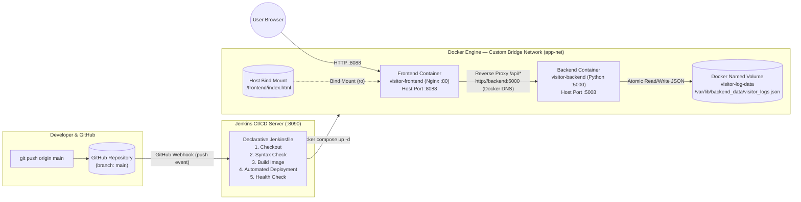

# 📊 Web Visitor Counter Log — Cloud-Native Fullstack Application & Automated CI/CD Pipeline

Proyek Ujian Tengah Semester (**Ujian Chunin**) Mata Kuliah **Cloud Computing** — Telkom University.  
**Studi Kasus #5:** Log & Hit Counter Pengunjung Web (*Web Visitor Counter Log*).

---

## 👥 Identitas Kelompok

| No | Nama Lengkap | NIM | Peran & Kontribusi |
|----|--------------|-----|--------------------|
| 1 | **Faiz Aditia Zain** | `101012330071` | Backend Python REST API (`app.py`, `Dockerfile`), `docker-compose.yml`, Setup Jenkins & Webhook |
| 2 | **Zaky Habiburrohman** | `101012300005` | Frontend Plain HTML & Vanilla JS (`index.html`), Nginx Reverse Proxy (`nginx.conf`), `Jenkinsfile` |
| 3 | **Khaza Ilmifikra Rif'a Kadar** | `101012300292` | Dokumentasi `README.md`, Diagram Arsitektur Docker, Simulasi Data Immunity & Video Demo |

---

## 🎥 Video Demo & Presentasi Kelompok (5–8 Menit)

- **Tautan Video Demo (YouTube / Google Drive):** **[MASUKKAN_LINK_VIDEO_DI_SINI]**
- **Cakupan Demonstrasi pada Video:**
  1. Penjelasan arsitektur kontainerisasi, isolasi jaringan `app-net`, dan alur CI/CD.
  2. Demonstrasi UI *real-time* (`fetch()` API), tombol *Delete* tanpa *reload*, pengujian REST API (`200`, `201`, `400 Bad Request`, `404 Not Found`), serta pembuktian **Bind Mount** pada kontainer Nginx.
  3. **Simulasi Data Immunity:** menghapus paksa kontainer backend (`docker rm -f visitor-backend`) lalu menyalakannya kembali (`docker compose up -d`) dan membuktikan data di dalam Named Volume `visitor-log-data` tetap utuh 100%.
  4. **Simulasi Automated CI/CD:** mengubah kode UI, melakukan `git push origin main`, hingga **Jenkins Pipeline (5 Stage)** ter-trigger otomatis melalui **GitHub Webhook** dan men-deploy perubahan secara *live*.

---

## 📝 Deskripsi Studi Kasus (#5: Log & Hit Counter Pengunjung Web)

**Web Visitor Counter Log** adalah sistem pencatat statistik kunjungan situs web laboratorium yang dibangun di atas arsitektur *cloud-native* terkontainerisasi dengan spesifikasi:

1. **Backend Service (`backend/app.py`):**
   - Dibangun menggunakan Python standard library (`http.server`) tanpa framework berat.
   - Menyediakan endpoint REST API berbasis JSON: `GET /logs`, `POST /logs`, `DELETE /logs?index=X`, dan `GET /health`.
   - Seluruh data disimpan secara atomik ke file JSON `/var/lib/backend_data/visitor_logs.json` di dalam **Docker Named Volume (`visitor-log-data`)**.
2. **Frontend Service (`frontend/index.html` & `frontend/nginx.conf`):**
   - Dibangun menggunakan Plain HTML & Vanilla JavaScript biasa tanpa framework.
   - Menggunakan `fetch()` API asynchronous untuk menambah, menampilkan, dan menghapus data secara *real-time* tanpa me-refresh halaman.
   - Dijalankan pada web server **Nginx (`nginx:1.27-alpine`)** menggunakan **Bind Mount** ke folder host lokal (`./frontend:/usr/share/nginx/html:ro`) agar perubahan kode UI langsung terlihat tanpa perlu *rebuild image*.
3. **Infrastruktur & Network Isolation (`docker-compose.yml`):**
   - Kontainer `frontend` dan `backend` terhubung di dalam **Custom Bridge Network terisolasi (`app-net`)** dan berkomunikasi menggunakan **Service Name / DNS Internal Docker** (`http://backend:5000`).
4. **Automated CI/CD Pipeline (`Jenkinsfile`):**
   - Menggunakan skrip **Declarative Pipeline** dengan **5 Stage utama**:
     1. `Checkout` — Menarik kode terbaru dari branch `main` GitHub.
     2. `Syntax Check` — Memvalidasi sintaks Python (`python3 -m py_compile backend/app.py`) dan konfigurasi Compose (`docker compose config -q`).
     3. `Build Image` — Membangun Docker image backend dengan versi nomor build (`visitor-log-backend:1.0.${BUILD_NUMBER}`).
     4. `Automated Deployment` — Menjalankan `docker compose up -d --force-recreate --remove-orphans`.
     5. `Health Check` — Memverifikasi layanan melalui network `app-net` (`GET /api/health` & `GET /api/logs`).

---

## 🏗️ Diagram Arsitektur Docker & CI/CD Pipeline



---

## 📂 Struktur Berkas Repositori

```text
.
├── backend/
│   ├── app.py                        # Python REST API (GET/POST/DELETE /logs + /health)
│   ├── Dockerfile                    # Image python:3.12-alpine (non-root + HEALTHCHECK)
│   └── .dockerignore
├── frontend/
│   ├── index.html                    # Dashboard UI Plain HTML + Vanilla JS fetch()
│   └── nginx.conf                    # Konfigurasi Nginx + Reverse Proxy ke http://backend:5000
├── jenkins/
│   ├── Dockerfile                    # Custom Jenkins LTS + Docker CLI + Compose Plugin
│   ├── docker-compose.jenkins.yml    # Compose file server Jenkins (:8090) & Webhook Relay
│   ├── job-config.xml                # Pre-configured Pipeline Job XML
│   └── smee_relay.py                 # Auto-reconnecting GitHub Webhook Relay
├── scripts/
│   └── test_api_and_immunity.ps1     # Skrip otomatis uji CRUD, error 400/404, & Data Immunity
├── docker-compose.yml                # Orkestrasi utama (backend, frontend, app-net, visitor-log-data)
├── Jenkinsfile                       # Declarative Pipeline 5 Stage
└── README.md                         # Dokumentasi proyek
```

---

## 🔌 Spesifikasi Endpoint REST API (`backend/app.py`)

| Method | Endpoint | Deskripsi | Status Code |
|--------|----------|-----------|-------------|
| `GET` | `/logs` | Mengambil total hit, jumlah pengunjung unik, statistik hit per halaman, dan daftar seluruh log | `200 OK` |
| `POST` | `/logs` | Menambahkan log kunjungan baru (`{"page": "/beranda", "visitor": "Faiz"}`) | `201 Created` / `400 Bad Request` |
| `DELETE` | `/logs?index=X` | Menghapus entri log pada indeks ke-`X` | `200 OK` / `400 Bad Request` / `404 Not Found` |
| `GET` | `/health` | Memeriksa status kesehatan service backend dan akses tulis Named Volume | `200 OK` |

### Contoh Pengujian API dengan `curl`

```bash
# 1. Tambah log kunjungan baru (201 Created)
curl -i -X POST http://localhost:8088/api/logs \
  -H "Content-Type: application/json" \
  -d '{"page":"/praktikum/modul-1","visitor":"Faiz - 101012330071"}'

# 2. Ambil seluruh log & statistik total hit (200 OK)
curl -s http://localhost:8088/api/logs

# 3. Uji Error Handling 400 Bad Request (tanpa field wajib 'page')
curl -i -X POST http://localhost:8088/api/logs \
  -H "Content-Type: application/json" \
  -d '{}'

# 4. Uji Error Handling 404 Not Found (index di luar jangkauan)
curl -i -X DELETE "http://localhost:8088/api/logs?index=999"

# 5. Hapus log pada index ke-0 (200 OK)
curl -i -X DELETE "http://localhost:8088/api/logs?index=0"
```

---

## 🚀 Langkah Instalasi Lokal (Docker Compose)

### 1. Clone Repositori & Jalankan Kontainer
```bash
git clone https://github.com/phyxa12/visitor-counter-cicd-agent.git
cd visitor-counter-cicd-agent
docker compose up -d --build
```

### 2. Akses Aplikasi
- **Frontend Dashboard (Nginx):** `http://localhost:8088`
- **Backend API via Reverse Proxy:** `http://localhost:8088/api/logs`
- **Backend API Langsung:** `http://localhost:5008/logs`

### 3. Verifikasi Isolasi Network & Named Volume
```bash
docker compose ps
docker network inspect app-net
docker volume inspect visitor-log-data
```

---

## 🛡️ Simulasi Data Immunity & Live Bind Mount

### A. Simulasi Data Immunity (Named Volume `visitor-log-data`)
Membuktikan bahwa data pada `visitor_logs.json` tetap tersimpan aman meskipun kontainer backend dihapus secara paksa:
```bash
# 1. Hapus paksa kontainer backend
docker rm -f visitor-backend

# 2. Nyalakan kembali kontainer backend
docker compose up -d

# 3. Cek kembali data melalui browser http://localhost:8088 atau curl -> Data 100% utuh!
curl -s http://localhost:8088/api/logs
```

### B. Simulasi Live Update UI (Bind Mount `./frontend`)
Edit file `frontend/index.html` di host lokal, simpan perubahan, lalu *refresh* browser pada `http://localhost:8088`. Perubahan tampilan langsung terlihat seketika tanpa perlu melakukan `docker compose build`.

---

## ⚙️ Langkah Setup Jenkins CI/CD & GitHub Webhook

### 1. Pembuatan GitHub Personal Access Token (PAT)
1. Buka GitHub $\rightarrow$ **Settings** $\rightarrow$ **Developer settings** $\rightarrow$ **Personal access tokens** $\rightarrow$ **Tokens (classic)** $\rightarrow$ **Generate new token (classic)**.
2. Isi Note: `Jenkins CI/CD UTS Token`, pilih masa berlaku token, dan centang izin wajib:
   - `[x] repo` (Full control of private/public repositories)
   - `[x] admin:repo_hook` (Full control of repository hooks)
3. Salin token (`ghp_xxxx...`) lalu tambahkan ke Jenkins pada menu **Manage Jenkins $\rightarrow$ Credentials $\rightarrow$ System $\rightarrow$ Global credentials $\rightarrow$ Add Credentials** (Kind: *Username with password*, ID: `github-pat`).

### 2. Menjalankan Server Jenkins & Webhook Relay
```bash
docker compose -f jenkins/docker-compose.jenkins.yml up -d --build
```
- **Dashboard Jenkins:** `http://localhost:8090/job/visitor-counter-pipeline/`
- Job pipeline `visitor-counter-pipeline` sudah terkonfigurasi otomatis membaca `Jenkinsfile` dari branch `main` dengan opsi **GitHub hook trigger for GITScm polling** aktif.
- Kontainer `chunin-webhook-relay` meneruskan setiap event `push` dari GitHub Webhook (`https://smee.io/tdH2L1SbpkA2L0S`) langsung ke `http://chunin-jenkins:8080/github-webhook/` sehingga setiap `git push origin main` otomatis mengeksekusi ke-5 stage pipeline.
