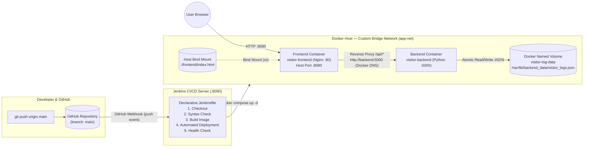

# 📊 Web Visitor Counter Log — Cloud-Native Fullstack Application & Automated CI/CD Pipeline

Proyek Ujian Tengah Semester (**Ujian Chunin**) Mata Kuliah **Cloud Computing** — Telkom University.  
**Studi Kasus #5:** Log & Hit Counter Pengunjung Web (*Web Visitor Counter Log*).

---

## 👥 Identitas Kelompok

| No | Nama Lengkap | NIM | Peran |
|----|--------------|-----|-------|
| 1 | **Faiz Aditia Zain** | `101012330071` | Backend Python REST API, Docker Compose, Jenkins & Webhook |
| 2 | **Zaky Habiburrohman** | `101012300005` | Frontend HTML & Vanilla JS, Nginx Reverse Proxy, `Jenkinsfile` |
| 3 | **Khaza Ilmifikra Rif'a Kadar** | `101012300292` | Dokumentasi, Diagram Arsitektur, Uji Data Immunity & Video Demo |

---

## 📝 Deskripsi Studi Kasus (#5)

**Web Visitor Counter Log** adalah sistem pencatat statistik kunjungan situs web laboratorium yang dibangun dengan arsitektur *cloud-native* terkontainerisasi:
1. **Backend Service (`backend/app.py`):** REST API berbasis Python standard library (`http.server`) tanpa framework berat. Menyimpan data secara atomik ke `/var/lib/backend_data/visitor_logs.json` di dalam Docker Named Volume **`visitor-log-data`**.
2. **Frontend Service (`frontend/index.html` & `frontend/nginx.conf`):** Dashboard interaktif berbasis Plain HTML & Vanilla JS (`fetch()` API asynchronous) tanpa framework. Dijalankan pada web server **Nginx** menggunakan **Bind Mount** ke direktori lokal sehingga perubahan UI langsung terlihat tanpa *rebuild image*.
3. **Network Isolation (`app-net`):** Kontainer `frontend` dan `backend` terhubung di dalam Custom Bridge Network terisolasi bernama **`app-net`** dan berkomunikasi menggunakan **Service Name / Docker Internal DNS** (`http://backend:5000`).
4. **Automated CI/CD (`Jenkinsfile`):** Declarative Pipeline 5 Stage (*Checkout, Syntax Check, Build Image, Automated Deployment, Health Check*) yang ter-trigger otomatis melalui **GitHub Webhook** setiap kali ada `git push` ke branch `main`.

---

## 🏗️ Diagram Arsitektur Docker & CI/CD Pipeline



---

## 📂 Struktur Repositori

```text
.
├── backend/
│   ├── app.py                        # Python REST API (GET/POST/DELETE /logs + /health)
│   ├── Dockerfile                    # Image python:3.12-alpine (non-root + HEALTHCHECK)
│   └── .dockerignore
├── frontend/
│   ├── index.html                    # Dashboard UI Plain HTML + Vanilla JS fetch()
│   └── nginx.conf                    # Konfigurasi Nginx + Reverse Proxy ke http://backend:5000
├── jenkins/
│   ├── Dockerfile                    # Custom Jenkins LTS + Docker CLI + Compose Plugin
│   └── docker-compose.jenkins.yml    # Compose file khusus server Jenkins (port 8090)
├── scripts/
│   └── test_api_and_immunity.ps1     # Skrip otomatis uji CRUD, 400/404, & Data Immunity
├── docker-compose.yml                # Orkestrasi utama (backend, frontend, app-net, visitor-log-data)
├── Jenkinsfile                       # Declarative Pipeline 5 Stage
└── README.md                         # Dokumentasi proyek
```

---

## 🔌 Spesifikasi Endpoint REST API

| Method | Endpoint | Deskripsi | Status Code |
|--------|----------|-----------|-------------|
| `GET` | `/logs` | Mengambil total hit, jumlah pengunjung unik, statistik hit per halaman, dan daftar log kunjungan | `200 OK` |
| `POST` | `/logs` | Menambahkan entri log kunjungan baru (`{"page": "/praktikum", "visitor": "Faiz"}`) | `201 Created` / `400 Bad Request` |
| `DELETE` | `/logs?index=X` | Menghapus entri log pada indeks ke-`X` | `200 OK` / `400 Bad Request` / `404 Not Found` |
| `GET` | `/health` | Memeriksa kesehatan service backend dan status penyimpanan volume | `200 OK` |

### Contoh Pengujian API dengan `curl`

```bash
# 1. Tambah log kunjungan baru (201 Created)
curl -i -X POST http://localhost:8080/api/logs \
  -H "Content-Type: application/json" \
  -d '{"page":"/praktikum/modul-1","visitor":"Faiz - 101012330071"}'

# 2. Ambil seluruh log & statistik total hit (200 OK)
curl -s http://localhost:8080/api/logs

# 3. Uji Error Handling 400 Bad Request (tanpa field wajib 'page')
curl -i -X POST http://localhost:8080/api/logs \
  -H "Content-Type: application/json" \
  -d '{}'

# 4. Uji Error Handling 404 Not Found (index di luar jangkauan)
curl -i -X DELETE "http://localhost:8080/api/logs?index=999"

# 5. Hapus log pada index ke-0 (200 OK)
curl -i -X DELETE "http://localhost:8080/api/logs?index=0"
```

---

## 🚀 Langkah Instalasi & Menjalankan Secara Lokal

### 1. Clone Repositori & Jalankan Stack Docker Compose
```bash
git clone https://github.com/phyxa12/visitor-counter-cicd-agent.git
cd visitor-counter-cicd-agent
docker compose up -d --build
```

### 2. Akses Layanan
- **Frontend Web UI:** [http://localhost:8080](http://localhost:8080)
- **Backend REST API (via Nginx Proxy):** [http://localhost:8080/api/logs](http://localhost:8080/api/logs)
- **Backend Health Check:** [http://localhost:8080/api/health](http://localhost:8080/api/health)

### 3. Verifikasi Network `app-net` & Named Volume `visitor-log-data`
```bash
docker network inspect app-net
docker volume inspect visitor-log-data
```

---

## 🛡️ Simulasi Data Immunity & Live Bind Mount

### A. Simulasi Data Immunity (Named Volume `visitor-log-data`)
Membuktikan data di dalam `visitor_logs.json` tidak hilang meskipun kontainer backend dihapus paksa:
```bash
# 1. Hapus paksa kontainer backend
docker rm -f visitor-backend

# 2. Buat ulang kontainer backend
docker compose up -d

# 3. Cek kembali data melalui API atau refresh http://localhost:8080 -> Data tetap utuh!
curl -s http://localhost:8080/api/logs
```

### B. Simulasi Live Update UI (Bind Mount `./frontend`)
Ubah teks apa pun pada file `frontend/index.html`, simpan perubahan, lalu *refresh* browser di `http://localhost:8080`. Perubahan tampilan langsung terlihat tanpa perlu menjalankan `docker compose build`.

---

## ⚙️ Langkah Setup Jenkins CI/CD & GitHub Webhook

1. **Jalankan Kontainer Jenkins (Port 8090):**
   ```bash
   docker compose -f jenkins/docker-compose.jenkins.yml up -d --build
   docker exec chunin-jenkins cat /var/jenkins_home/secrets/initialAdminPassword
   ```
2. **Setup Awal Jenkins:**
   - Buka `http://localhost:8090`, masukkan *Initial Admin Password*, dan pilih **Install suggested plugins**.
3. **Konfigurasi GitHub Personal Access Token (PAT):**
   - Buat PAT Classic di GitHub (**Settings -> Developer settings -> Personal access tokens -> Tokens (classic)**) dengan scope **`repo`** dan **`admin:repo_hook`**.
   - Tambahkan di Jenkins pada menu **Manage Jenkins -> Credentials -> System -> Global credentials -> Add Credentials** (Kind: *Username with password*, ID: `github-pat`).
4. **Buat Pipeline Job:**
   - Klik **New Item** -> pilih **Pipeline** -> beri nama `visitor-counter-pipeline`.
   - Centang **GitHub hook trigger for GITScm polling**.
   - Pilih **Pipeline script from SCM** -> **Git** -> masukkan URL repositori, pilih credential `github-pat`, branch `*/main`, dan Script Path `Jenkinsfile`.
5. **Aktifkan GitHub Webhook Relay (Untuk Jenkins Lokal):**
   ```bash
   npx --yes smee-client -u https://smee.io/<CHANNEL_ID> -t http://localhost:8090/github-webhook/
   ```
   Masukkan URL `https://smee.io/<CHANNEL_ID>` ke menu **Settings -> Webhooks -> Add webhook** di repositori GitHub (`Content type: application/json`, event: `Just the push event`).
